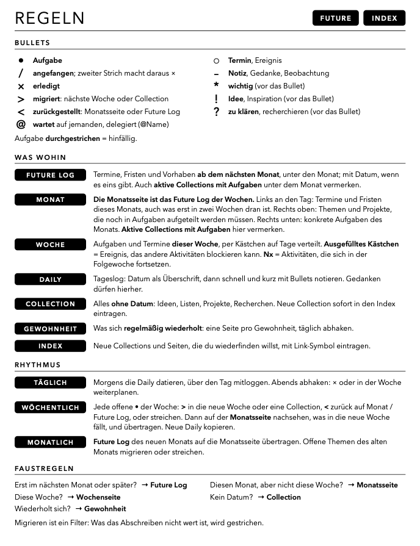
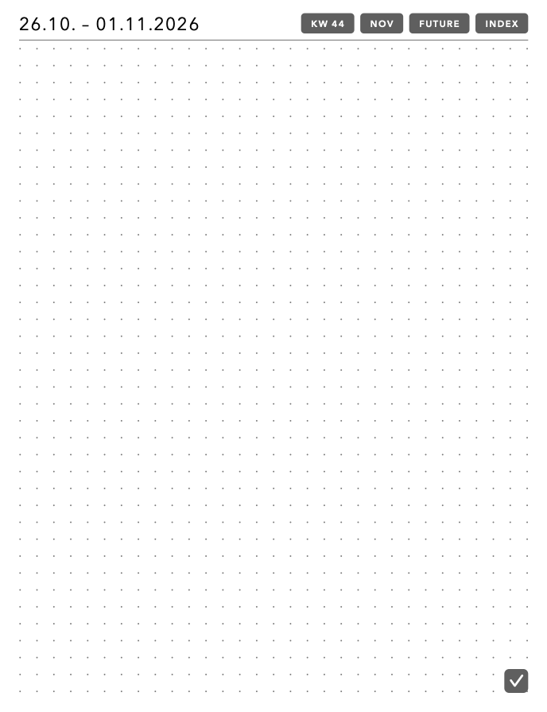
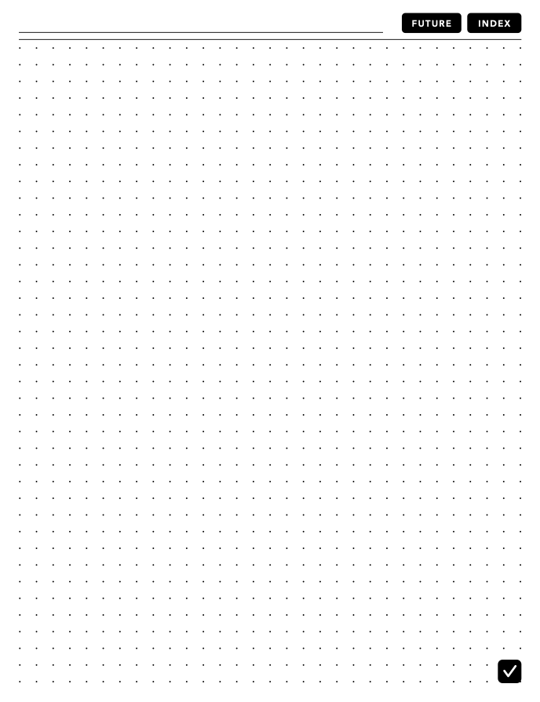

# BOOX Bullet Journal

Vorlagen-PDF für ein Bullet Journal auf dem BOOX-Reader, Aufbau nach Ryder
Carrolls Bullet-Journal-Methode. Das PDF in der Notes-App öffnen (nicht als
Vorlage importieren).

Zusätzliche Seiten nicht über „Page+“ einfügen, sondern in der
Seitenübersicht kopieren: Nach jeder Wochenseite folgt eine Wochen-Daily.
Bevor sie beschrieben wird, diese Daily in der Seitenübersicht kopieren. So
liegt immer eine leere Daily mit allen Links bereit. Genauso eine Gewohnheitsseite pro Gewohnheit und weitere
Collections kopieren.

## Regeln

Die Regelseite (Seite 3) fasst zusammen, wie das Journal geführt wird.

**Bullets**

| Symbol | Bedeutung |
|:---:|---|
| • | Aufgabe |
| / | angefangen; zweiter Strich macht daraus × |
| × | erledigt |
| > | migriert: nächste Woche oder Collection |
| < | zurückgestellt: Monatsseite oder Future Log |
| @ | wartet auf jemanden, delegiert (@Name) |
| ○ | Termin, Ereignis |
| – | Notiz, Gedanke, Beobachtung |
| * | wichtig (vor das Bullet) |
| ! | Idee, Inspiration (vor das Bullet) |
| ? | zu klären, recherchieren (vor das Bullet) |

Eine durchgestrichene Aufgabe ist hinfällig.

**Was wohin**

- Future Log: Termine, Fristen und Vorhaben ab dem nächsten Monat, unter den Monat; mit Datum, wenn es eins gibt. Auch aktive Collections mit Aufgaben unter dem Monat vermerken.
- Monat: Die Monatsseite ist das Future Log der Wochen. Links an den Tag: Termine und Fristen dieses Monats. Rechts oben: Themen und Projekte, die noch in Aufgaben aufgeteilt werden müssen; rechts unten: konkrete Aufgaben des Monats. Aktive Collections mit Aufgaben hier vermerken.
- Woche: Aufgaben und Termine dieser Woche, per Kästchen auf Tage verteilt. Ausgefülltes Kästchen = Ereignis, das andere Aktivitäten blockieren kann. Nx = Aktivitäten, die sich in der Folgewoche fortsetzen.
- Daily: Tageslog mit Datum als Überschrift, kurz mit Bullets.
- Collection: alles ohne Datum (Ideen, Listen, Projekte); neue Collections in den Index eintragen.
- Gewohnheit: was sich regelmäßig wiederholt, eine Seite pro Gewohnheit.
- Index: neue Collections und Seiten, die man wiederfinden will.

**Rhythmus**

- Täglich: Daily datieren, mitloggen, abends abhaken oder in der Woche weiterplanen.
- Wöchentlich: jede offene Aufgabe mit > in die neue Woche oder eine Collection, mit < zurück auf Monat / Future Log, oder streichen. Dann auf der Monatsseite nachsehen, was in die neue Woche fällt, und übertragen.
- Monatlich: Future Log des neuen Monats auf die Monatsseite übertragen, offene Themen migrieren oder streichen.

Migrieren ist ein Filter: Was das Abschreiben nicht wert ist, wird gestrichen.

## Navigation

Navigation über PDF-Links:

- Deckblatt: Monatsleiste → Monat
- Index: vorbelegte Einträge für Regeln, Future Log, alle Monate, die Wochen, die Gewohnheiten und die Collections
- Regeln: FUTURE, INDEX
- Future Log: Monatsbalken → Monat, INDEX
- Monat: ‹ › Vor-/Folgemonat, KW-Badges → Woche, FUTURE, INDEX
- Woche: ‹ › Vor-/Folgewoche, Monatsknöpfe (z. B. DEZ, JAN) → Monat, FUTURE, INDEX
- Wochen-Daily: KW → Woche, Monatsknöpfe → Monat, FUTURE, INDEX
- Gewohnheit: KW-Beschriftungen → Woche, INDEX
- Collection: FUTURE, INDEX
- Alle Seiten außer Deckblatt, Regeln und Gewohnheit: Knopf ✓ unten rechts → Gewohnheitsseite

In BOOX Notes bleiben die Links korrekt, auch wenn Seiten eingefügt oder
kopiert werden; kopierte Seiten behalten ihre eigenen Links (getestet).

## Inhalt von `BuJo-2027 V2.1.pdf`

| Seiten | Inhalt |
|---|---|
| 1 | Deckblatt mit Zeitraum und Monatsleiste |
| 2 | Index (Thema / Seiten) |
| 3 | Regeln: Bullets, was wohin, Rhythmus, Faustregeln |
| 4–8 | Future Log, drei Monate pro Seite |
| 9–22 | Monatsseiten Nov 2026 – Dez 2027 (Tagesliste mit KW + Punktraster) |
| 23–146 | KW 44/2026 – KW 52/2027, je zwei Seiten: Wochenseite (Aufgaben, Mo–So mit Datum, Next) und Wochen-Daily (Datumsbereich, Punktraster) |
| 147 | Gewohnheits-Tracker: eine Seite pro Gewohnheit (auf dem BOOX kopieren), alle Wochen des Zeitraums als Zeilen Mo–So |
| 148–149 | Collections: leere Schreiblinie für das Thema, Punktraster |

Format 458,88 × 597,12 pt (3:4).

## Vorschau

| Deckblatt | Index | Regeln |
|:---:|:---:|:---:|
|  |  |  |
| **Future Log** | **Monat** | **Woche** |
|  |  |  |
| **Wochen-Daily** | **Gewohnheit** | **Collection** |
|  |  |  |

## Neu erzeugen

Zeitraum über `startYear`/`startMonth`/`endYear`/`endMonth` oben in
`generate_bujo.swift` einstellen, dann PDF und Vorschaubilder erzeugen:

```bash
swift generate_bujo.swift && swift render_previews.swift
```

Nach jeder Layout-Änderung beide Befehle ausführen und `previews/` mit
committen, damit die Vorschau aktuell bleibt.

Benötigt nur macOS (CoreGraphics/CoreText), keine weiteren Abhängigkeiten.

## Lizenz

MIT, siehe [LICENSE](LICENSE). Gilt für Skripte und das erzeugte PDF.
