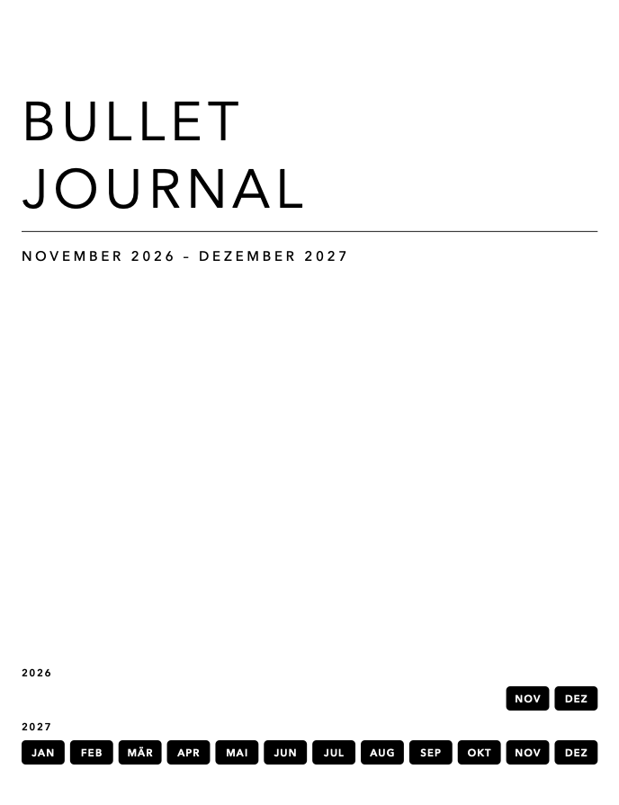
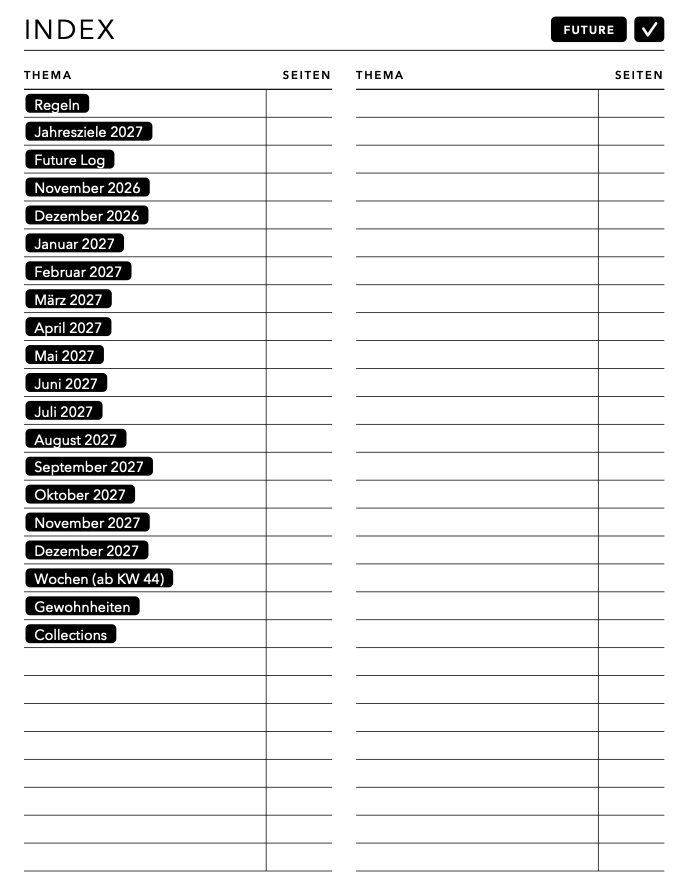
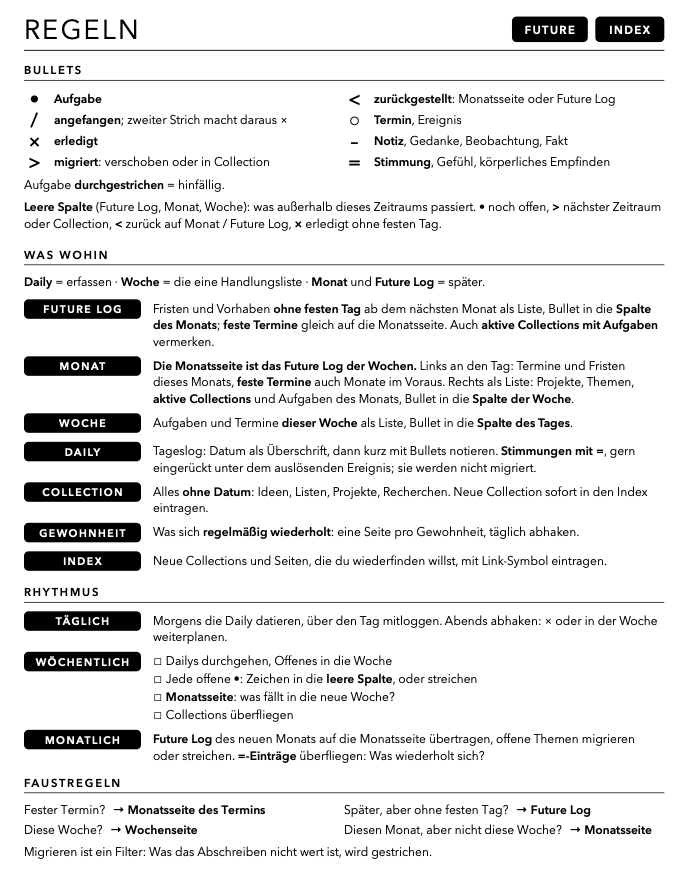
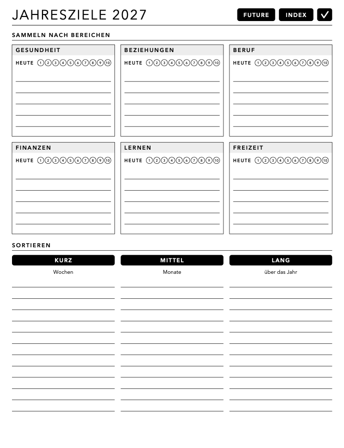
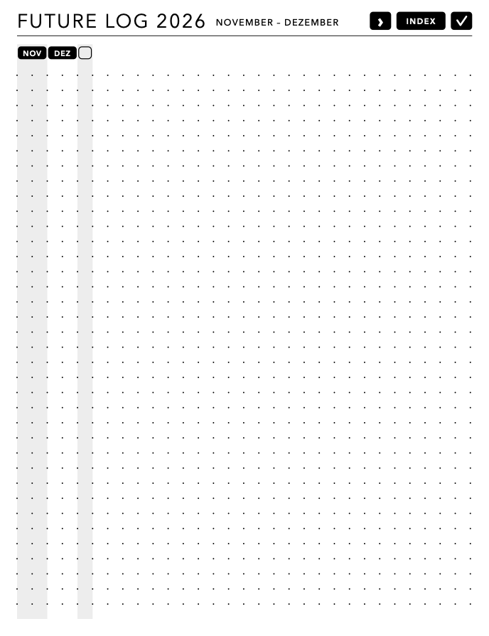
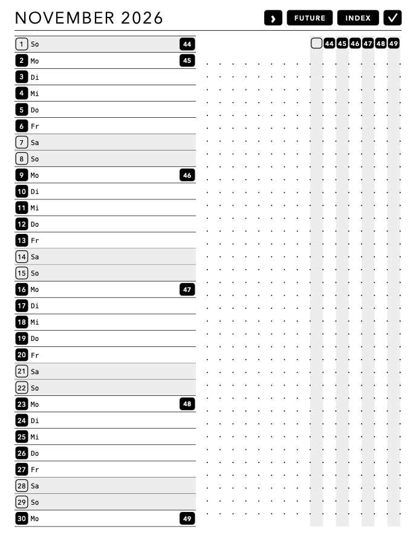
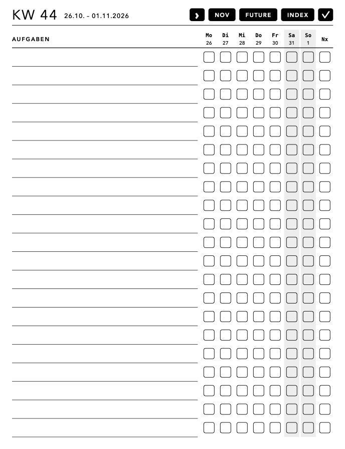
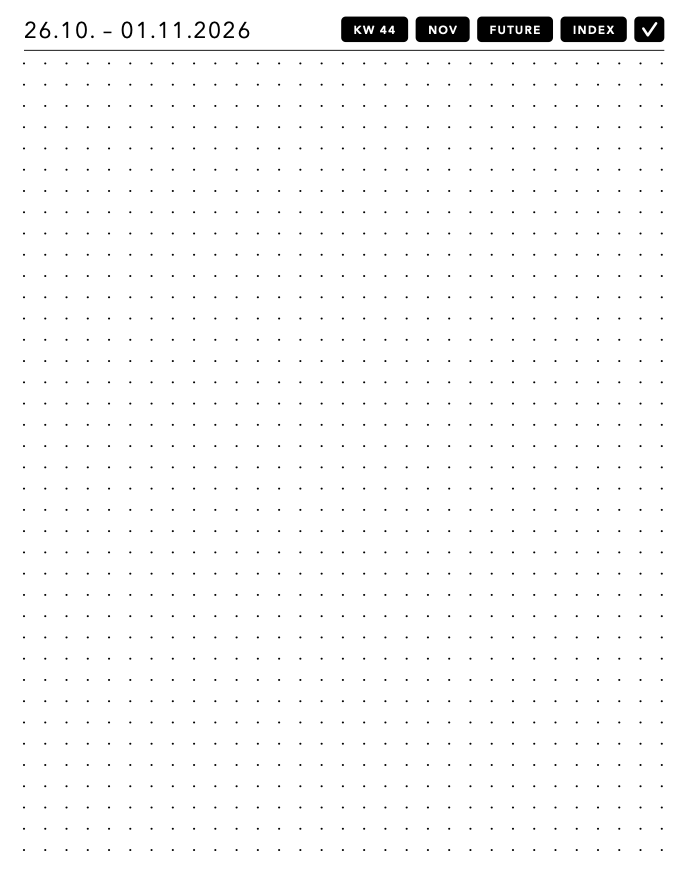
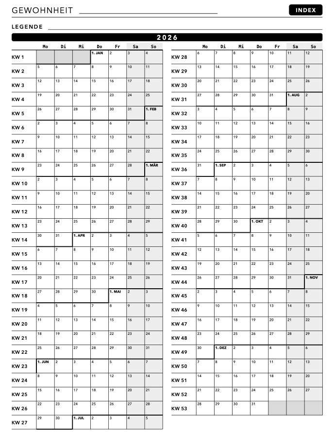
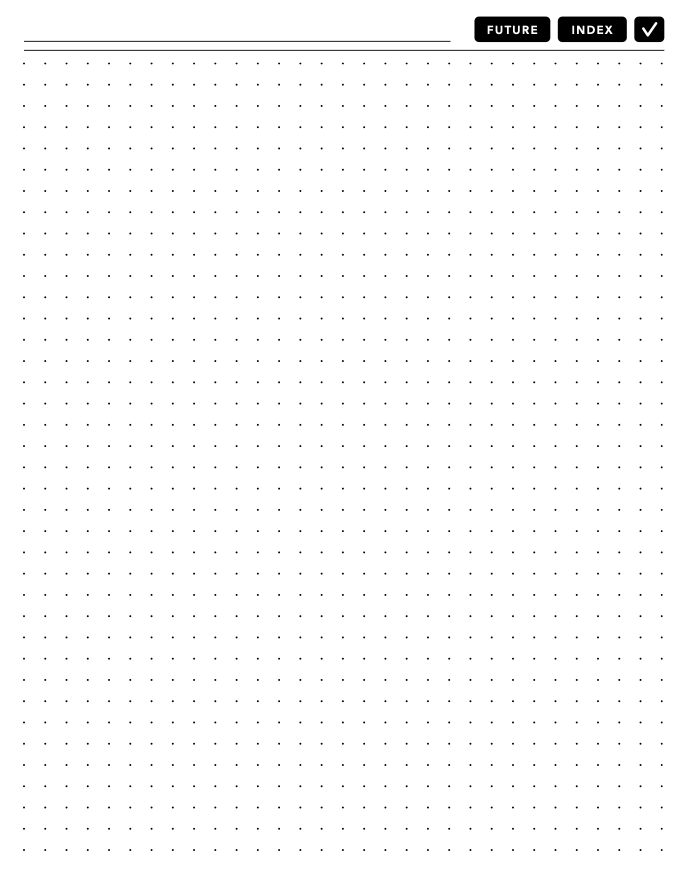

# BOOX Bullet Journal

Vorlagen-PDF für ein Bullet Journal auf dem BOOX-Reader, Aufbau nach Ryder
Carrolls Bullet-Journal-Methode. Das PDF in der Notes-App öffnen (nicht als
Vorlage importieren).

Zusätzliche Seiten nicht über „Page+“ einfügen, sondern in der
Seitenübersicht kopieren: Nach jeder Wochenseite folgt eine Wochen-Daily.
Bevor sie beschrieben wird, diese Daily in der Seitenübersicht kopieren. So
liegt immer eine leere Daily mit allen Links bereit. Genauso eine Gewohnheitsseite pro Gewohnheit und weitere
Collections kopieren.

## Regeln

Die Regelseite (Seite 3) fasst zusammen, wie das Journal geführt wird.

**Bullets**

| Symbol | Bedeutung |
|:---:|---|
| • | Aufgabe |
| / | angefangen; zweiter Strich macht daraus × |
| × | erledigt |
| > | migriert: verschoben oder in Collection |
| < | zurückgestellt: Monatsseite oder Future Log |
| @ | wartet auf jemanden, delegiert (@Name) |
| ○ | Termin, Ereignis |
| – | Notiz, Gedanke, Beobachtung, Fakt |
| = | Stimmung, Gefühl, körperliches Empfinden |
| * | wichtig (vor das Bullet) |
| ! | Idee, Inspiration (vor das Bullet) |
| ? | zu klären, recherchieren (vor das Bullet) |

Eine durchgestrichene Aufgabe ist hinfällig.

**Was wohin**

- Future Log: Fristen und Vorhaben ohne festen Tag ab dem nächsten Monat, unter den Monat; feste Termine gleich auf die Monatsseite. Auch aktive Collections mit Aufgaben vermerken.
- Monat: Die Monatsseite ist das Future Log der Wochen. Links an den Tag: Termine und Fristen dieses Monats, feste Termine auch Monate im Voraus. Rechts oben: Themen und Projekte, die noch in Aufgaben aufgeteilt werden müssen; rechts unten: konkrete Aufgaben des Monats. Aktive Collections mit Aufgaben hier vermerken.
- Woche: Aufgaben und Termine dieser Woche. In den Tagesspalten: • geplant, × erledigt, > verschoben (am neuen Tag •), ○ Termin; daneben das Bullet der Aufgabe. Nx = geht in der Folgewoche weiter.
- Daily: Tageslog mit Datum als Überschrift, kurz mit Bullets. Stimmungen mit =, gern eingerückt unter dem auslösenden Ereignis; sie werden nicht migriert.
- Collection: alles ohne Datum (Ideen, Listen, Projekte); neue Collections in den Index eintragen.
- Gewohnheit: was sich regelmäßig wiederholt, eine Seite pro Gewohnheit.
- Index: neue Collections und Seiten, die man wiederfinden will.

**Rhythmus**

- Täglich: Daily datieren, mitloggen, abends abhaken oder in der Woche weiterplanen.
- Wöchentlich: jede offene Aufgabe mit > in die neue Woche oder eine Collection, mit < zurück auf Monat / Future Log, oder streichen. Dann auf der Monatsseite nachsehen, was in die neue Woche fällt, und übertragen.
- Monatlich: Future Log des neuen Monats auf die Monatsseite übertragen, offene Themen migrieren oder streichen. =-Einträge überfliegen: Was wiederholt sich?

Migrieren ist ein Filter: Was das Abschreiben nicht wert ist, wird gestrichen.

## Navigation

Navigation über PDF-Links:

- Deckblatt: Monatsleiste → Monat
- Index: vorbelegte Einträge für Regeln, Jahresziele, Future Log, alle Monate, die Wochen, die Gewohnheiten und die Collections
- Regeln: FUTURE, INDEX
- Jahresziele: FUTURE, INDEX
- Future Log: Monatsbalken → Monat, INDEX
- Monat: ‹ › Vor-/Folgemonat, KW-Badges → Woche, FUTURE, INDEX
- Woche: ‹ › Vor-/Folgewoche, Monatsknöpfe (z. B. DEZ, JAN) → Monat, FUTURE, INDEX
- Wochen-Daily: KW → Woche, Monatsknöpfe → Monat, FUTURE, INDEX
- Gewohnheit: KW-Beschriftungen (ab KW 44/2026) → Woche, INDEX
- Collection: FUTURE, INDEX
- Alle Seiten außer Deckblatt, Regeln und Gewohnheit: Knopf ✓ oben rechts (letzter Knopf der Leiste) → Gewohnheitsseite; auf Monats-, Wochen- und Daily-Seiten die des passenden Jahres, sonst die erste

In BOOX Notes bleiben die Links korrekt, auch wenn Seiten eingefügt oder
kopiert werden; kopierte Seiten behalten ihre eigenen Links (getestet).

## Inhalt von `BuJo-2027 V2.1.pdf`

| Seiten | Inhalt |
|---|---|
| 1 | Deckblatt mit Zeitraum und Monatsleiste |
| 2 | Index (Thema / Seiten) |
| 3 | Regeln: Bullets, was wohin, Rhythmus, Faustregeln |
| 4 | Jahresziele: sechs Lebensbereiche mit Zufriedenheit 1–10 und Zielen, darunter nach kurz / mittel / lang sortieren |
| 5–10 | Future Log, ein Kalenderquartal pro Seite: Nov/Dez 2026, vier Quartale 2027, Jan–Mär 2028 (ohne Monatsseite) |
| 11–24 | Monatsseiten Nov 2026 – Dez 2027 (Tagesliste mit KW + Punktraster) |
| 25–148 | KW 44/2026 – KW 52/2027, je zwei Seiten: Wochenseite nach der Alastair-Methode (Spalten Mo–So mit Datum und Nx links, Bullet-Spalte, Aufgaben) und Wochen-Daily (Datumsbereich, Punktraster) |
| 149–150 | Gewohnheits-Tracker 2026 und 2027: je Kalenderjahr eine Seite (pro Gewohnheit auf dem BOOX kopieren), alle Wochen des Jahres als Zeilen Mo–So in zwei Spalten |
| 151–152 | Collections: leere Schreiblinie für das Thema, Punktraster |

Format 458,88 × 597,12 pt (3:4).

## Vorschau

| Deckblatt | Index | Regeln |
|:---:|:---:|:---:|
|  |  |  |
| **Jahresziele** | **Future Log** | **Monat** |
|  |  |  |
| **Woche** | **Wochen-Daily** | **Gewohnheit** |
|  |  |  |
| **Collection** | | |
|  | | |

## Neu erzeugen

Zeitraum über `startYear`/`startMonth`/`endYear`/`endMonth` oben in
`generate_bujo.swift` einstellen (`futureExtraMonths`: wie viele Monate das
Future Log über das Ende hinausreicht), dann PDF und Vorschaubilder erzeugen:

```bash
swift generate_bujo.swift && swift render_previews.swift
```

Nach jeder Layout-Änderung beide Befehle ausführen und `previews/` mit
committen, damit die Vorschau aktuell bleibt.

Benötigt nur macOS (CoreGraphics/CoreText), keine weiteren Abhängigkeiten.

## Lizenz

MIT, siehe [LICENSE](LICENSE). Gilt für Skripte und das erzeugte PDF.
