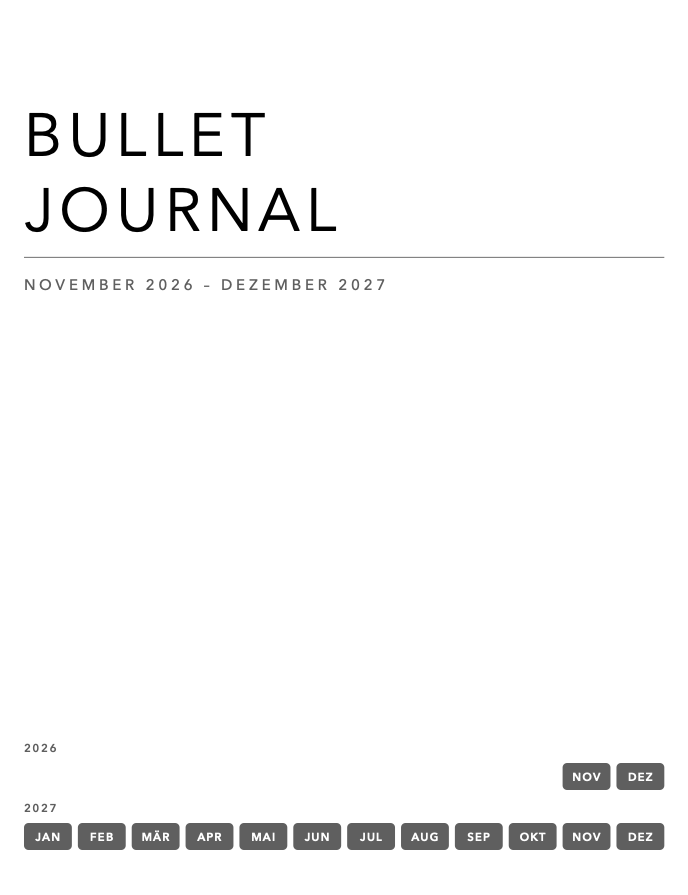
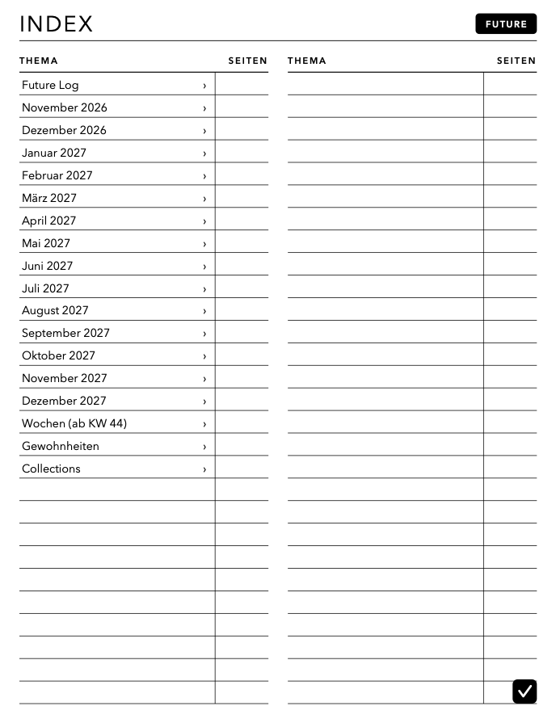
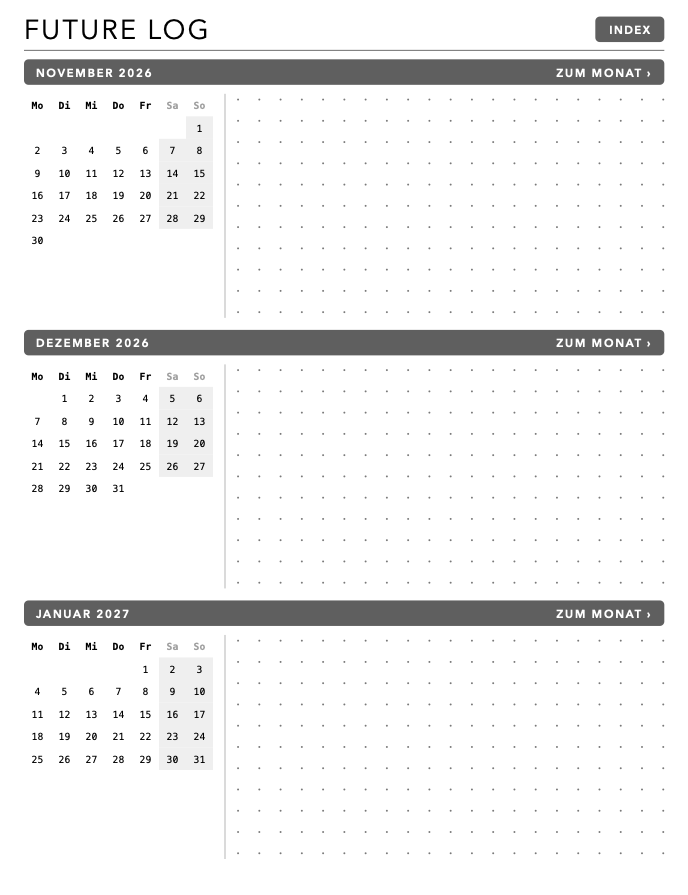
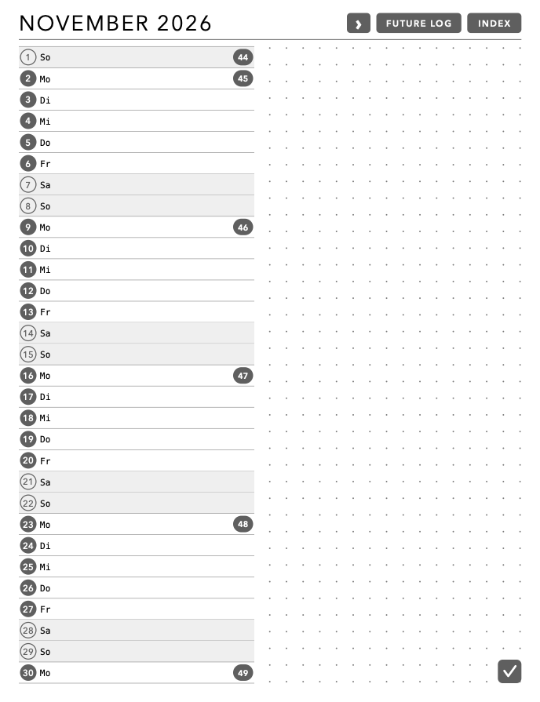
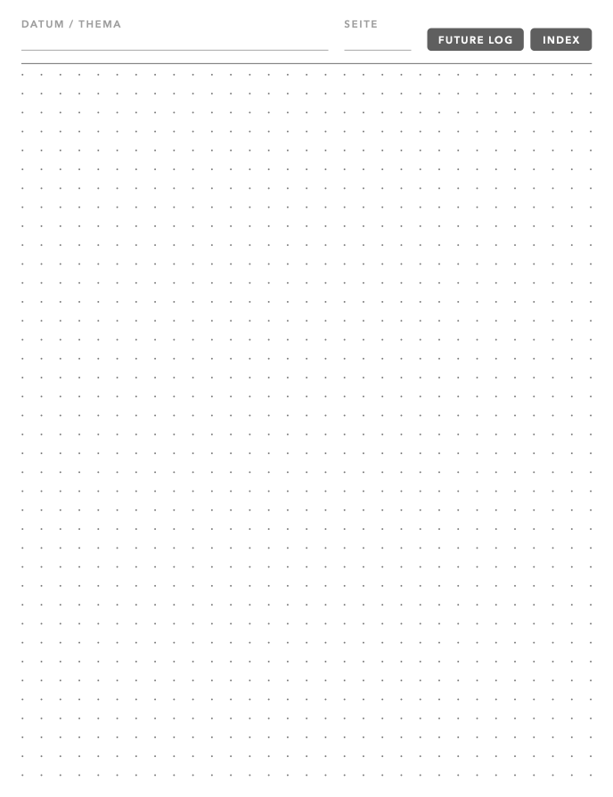
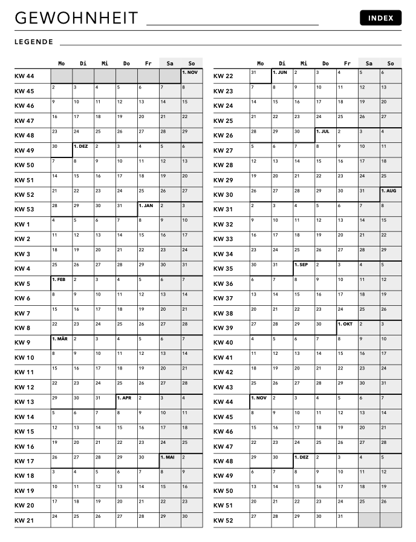

# BOOX Bullet Journal

Vorlagen-PDF für ein Bullet Journal auf dem BOOX-Reader, Aufbau nach Ryder
Carrolls Bullet-Journal-Methode. Das PDF in der Notes-App öffnen (nicht als
Vorlage importieren); weitere Seiten mit „Page+“ einfügen.

Navigation über PDF-Links: Deckblatt-Monatsleiste → Monat, Index (mit vorbelegten Einträgen für Future Log und
alle Monate) ↔ Future Log, Future-Log-Monatsbalken → Monat, Monatsseiten mit ‹ ›
sowie FUTURE LOG und INDEX, Daily → FUTURE LOG und INDEX, Woche/Tracker → INDEX.
In BOOX Notes bleiben die Links korrekt, auch wenn Seiten eingefügt werden
(getestet).

## Inhalt von `BuJo-Seiten-2026-11_2027-12.pdf`

| Seiten | Inhalt |
|---|---|
| 1 | Deckblatt mit Zeitraum und Monatsleiste |
| 2 | Index (Thema / Seiten) |
| 3–7 | Future Log, drei Monate pro Seite |
| 8–21 | Monatsseiten Nov 2026 – Dez 2027 (Tagesliste mit KW + Punktraster) |
| 22 | Wochenseite (Aufgaben, Mo–So, Next) |
| 23 | Daily / Collection (Punktraster) |
| 24 | Gewohnheits-Tracker: eine Seite pro Gewohnheit (auf dem BOOX kopieren), alle Wochen des Zeitraums als Zeilen Mo–So |

Format 458,88 × 597,12 pt (3:4).

## Vorschau

| Deckblatt | Index | Future Log |
|:---:|:---:|:---:|
|  |  |  |
| **Monat** | **Woche** | **Daily / Collection** |
|  |  |  |
| **Gewohnheit** | | |
|  | | |

## Neu erzeugen

Zeitraum über `startYear`/`startMonth`/`endYear`/`endMonth` oben in
`generate_bujo.swift` einstellen, dann PDF und Vorschaubilder erzeugen:

```bash
swift generate_bujo.swift && swift render_previews.swift
```

Nach jeder Layout-Änderung beide Befehle ausführen und `previews/` mit
committen, damit die Vorschau aktuell bleibt.

Benötigt nur macOS (CoreGraphics/CoreText), keine weiteren Abhängigkeiten.
